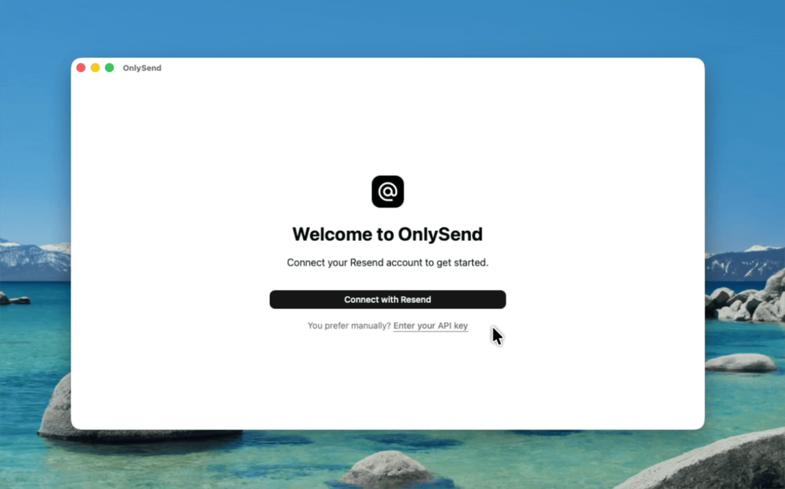

# OnlySend

Send email from your own domain with **Resend**, without leaving your desktop.
Connect multiple accounts, compose rich-text messages, and optionally receive mail.

[Download OnlySend](https://github.com/rxtsel/onlysend/releases)

## Get started

1. Install OnlySend and connect your Resend account with OAuth or an API key.
2. Follow the setup wizard to choose your domains and sender addresses.
3. Compose and send. Enable receiving only if you want an inbox.

You need a Resend account and access to your domain's DNS settings. Sending
requires a verified domain. Enabling receiving can redirect existing mail through
new MX records; review the DNS instructions before changing them.

## What you can do

- Switch between accounts with separate mail and settings.
- Manage multiple domains, sender addresses, and DNS configuration.
- Compose formatted messages with attachments, CC, BCC, and Reply-To.
- Browse sent mail and an optional inbox.
- Read downloaded message bodies offline, including after restarting the app.
  The footer shows local-copy progress and errors.

## Inbox notifications

OnlySend checks connected accounts from Rust every **5 minutes**, including when
the window is minimized or another screen is open. In **Settings → Notifications**,
choose 5, 10, 30 or 60 minutes, or turn automatic checks and notifications off.
The Refresh button still works when automatic checks are off.

The first successful check establishes a silent baseline. Subsequent checks
notify only new arrivals, with per-account checkpoints retained across restarts.
Notifications display a count, not email contents. Failed checks back off rather
than repeatedly hitting the API. System notification settings can suppress alerts.

OnlySend must remain running; quitting the app stops checks. Automatic checks
fetch new inbox metadata, not the full archive on every interval. An explicit
Refresh also retries the background archive download.

## Downloads and updates

Release builds target Linux (`.deb` and `.AppImage`), Windows (`.exe`), and macOS
(`.dmg`, Intel and Apple Silicon). Download the matching file from
[GitHub Releases](https://github.com/rxtsel/onlysend/releases).

Updater-enabled builds check once when opened. You can also use
**Settings → About → Check for updates**. Installation is your choice; the app
asks about unsaved drafts before closing. Debian installations use the package
manager rather than the in-app installer.

macOS builds are not notarized and may require approval in **Privacy & Security**.
Windows may show a SmartScreen warning. Older versions without the updater need
one manual installation to receive in-app updates.

## Your data

OnlySend uses Resend for sending and receiving; no separate OnlySend mail server
is required. Downloaded messages are kept locally even if they disappear from
Resend's lists. Disconnecting an account does not erase its local archive.

Local storage is **not encrypted**. Offline copies include message bodies and
attachment metadata, not attachment files or remote images.

## Website

The static Astro + Tailwind website lives in [`website/`](website/README.md), with
English and Spanish pages and a GitHub Pages deployment workflow.

## Contributing

For development, testing, and release instructions, see [CONTRIBUTIONS.md](CONTRIBUTIONS.md).

Licensed under [GPL-2.0-only](LICENSE).
